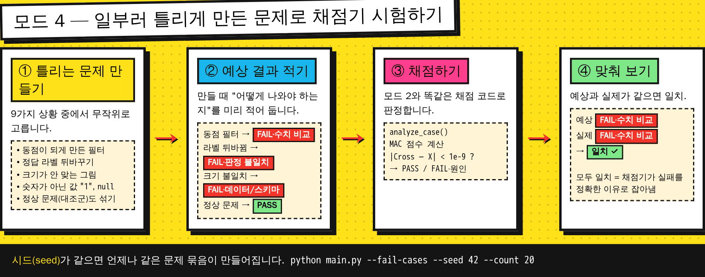
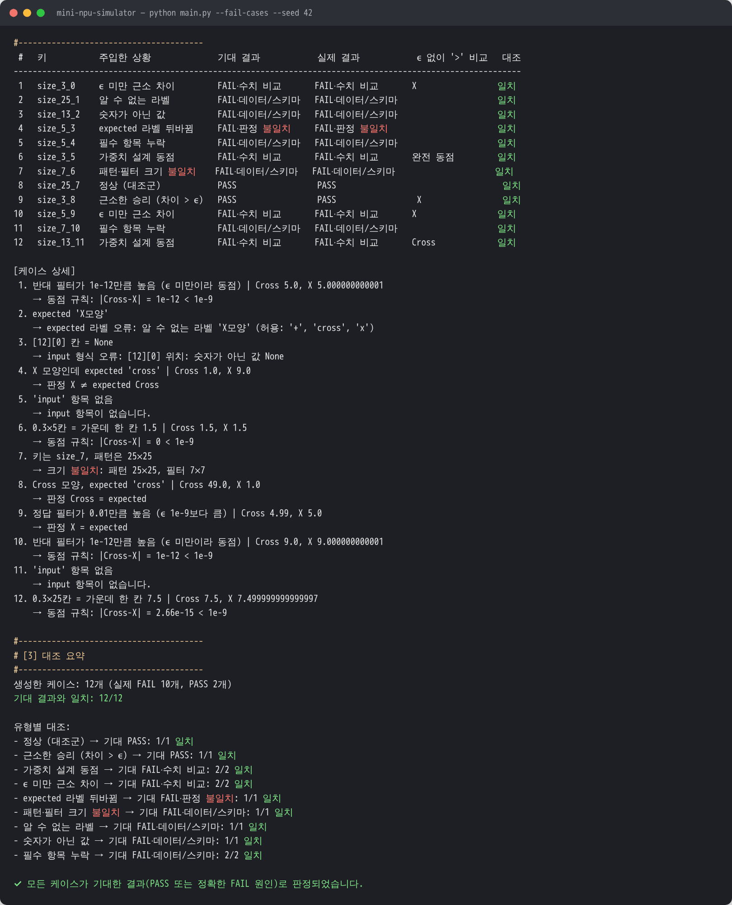

# 🧮 Mini NPU Simulator

[](https://github.com/buildergarlic/mini-npu-simulator/actions/workflows/docker.yml)

AI 칩(NPU)이 이미지를 판별할 때 쓰는 **MAC(Multiply-Accumulate) 연산**을 Python으로 직접 구현한 콘솔 프로그램입니다.
숫자 배열로 된 패턴이 **십자가(Cross)** 인지 **X** 인지 판별하고, 패턴 크기(3×3 ~ 25×25 이상)에 따라 연산 시간이 어떻게 늘어나는지 측정합니다.

- 외부 라이브러리 없음 (NumPy 등 미사용, `json`·`time`·`re`·`math`·`unicodedata`·`pathlib` 표준 라이브러리만 사용)
- Python 3.8 이상 (3.8.20, 3.13에서 동작·테스트 확인)
- **모드 4: FAIL 케이스 무작위 생성 + 결과 대조** — 실패해야 하는 상황 9종을 무작위로 만들어 판정하고, 기대한 실패 원인과 실제 결과를 자동으로 맞춰 봅니다 ([5장 모드 4](#모드-4--fail-케이스-무작위-생성--결과-대조))
- Docker로 Windows·macOS·Linux 어디서나 같은 환경(Python 3.12.16 고정)에서 실행 가능, push마다 자동 검사 ([9. Docker 실행 가이드](#9-docker-실행-가이드--어떤-개발-환경에서도-똑같이-재현하기))


> **처음 보는 분께:** [0. 초보자를 위한 이해·설명 가이드](#beginner-guide)에서 숫자 그림, MAC 계산, 실습, 동점 이유와 발표문을 먼저 확인하세요.

---

<a id="beginner-guide"></a>

## 0. 초보자를 위한 이해·설명 가이드

**이 프로그램은 숫자로 그린 그림을 ‘십자가 채점표’와 ‘X 채점표’에 각각 대조해서, 점수가 높은 쪽으로 분류하는 교육용 프로그램입니다.**

처음에는 다음 세 가지부터 이해하면 됩니다.

1. 그림을 숫자로 표현합니다.
2. 그림과 기준표에서 같은 위치의 숫자끼리 곱하고, 그 결과를 모두 더합니다.
3. 두 점수를 비교해 십자가인지 X인지 판정합니다. 점수가 거의 같으면 판정을 보류합니다.

아래 설명은 [main.py](main.py)의 실제 구현과 [data.json](data.json)의 데이터를 기준으로 작성했습니다. 먼저 원리를 읽고, **모드 1 → 모드 3 → 모드 2** 순서로 실행하면 기본 계산에서 크기 변화, 동점 사례까지 차례로 이해할 수 있습니다.

### 0-1. 그림을 어떻게 숫자로 표현하나요?

작은 바둑판에 그림을 그린다고 생각해 보세요. 가장 쉬운 예에서는 **그림이 있는 칸을 1, 비어 있는 칸을 0**으로 표현합니다.

아래는 가로 3칸, 세로 3칸으로 만든 십자가와 X입니다. 각 칸의 숫자는 왼쪽부터 읽습니다.

| 줄 | 입력 그림: 십자가 | 필터 A: 십자가 | 필터 B: X |
|---|---|---|---|
| 첫째 줄 | `0 1 0` | `0 1 0` | `1 0 1` |
| 둘째 줄 | `1 1 1` | `1 1 1` | `0 1 0` |
| 셋째 줄 | `0 1 0` | `0 1 0` | `1 0 1` |

**입력 그림은 검사할 대상이고, 필터(filter)는 칸마다 배점이 적힌 채점표입니다.** 위 예시에서는 필터의 배점도 0 또는 1입니다.

- 십자가 입력과 십자가 필터를 겹치면, 같은 위치에서 1이 만나는 칸이 다섯 개이므로 **5점**입니다.
- 같은 입력과 X 필터를 겹치면, 가운데 한 칸에서만 1이 만나므로 **1점**입니다.
- 두 점수를 비교하면 십자가 필터의 점수가 높으므로 **십자가로 판정**합니다.

입력 그림을 X로 바꾸면 반대로 십자가 필터에서 1점, X 필터에서 5점이 나옵니다.

> ‘겹치는 칸 수가 점수’라는 설명은 위처럼 값이 0과 1인 예시에 해당합니다. 실제 `data.json`에는 0.1, 0.9 등 서로 다른 배점이 들어 있으므로, 일반적인 점수는 **각 칸의 곱을 모두 더한 값**으로 이해해야 합니다.

### 0-2. MAC은 ‘곱하고 더하기’입니다

**MAC = Multiply-Accumulate**입니다. Multiply는 ‘곱하기’, Accumulate는 ‘결과를 계속 더해서 쌓기’라는 뜻입니다.

| 입력 그림의 한 칸 | 필터의 같은 칸 | 곱한 결과 | 총점에 더하는 값 |
|---:|---:|---:|---:|
| 1 | 1 | 1 × 1 = 1 | 1점 |
| 1 | 0 | 1 × 0 = 0 | 0점 |
| 0 | 1 | 0 × 1 = 0 | 0점 |
| 0 | 0 | 0 × 0 = 0 | 0점 |

이 계산을 모든 칸에서 반복해 더하면 해당 필터의 MAC 점수가 됩니다. 예를 들어 가중치가 0.9인 칸에서는 입력이 1일 때 `1 × 0.9 = 0.9`점을 더합니다.

`main.py`의 `mac_2d()`에서 핵심이 되는 부분은 다음과 같습니다. 여기서 `a`는 입력 그림, `b`는 필터, `n`은 한 변의 칸 수입니다.

```python
total = 0.0
for i in range(n):
    for j in range(n):
        total += a[i][j] * b[i][j]
```

| 코드 | 쉬운 뜻 |
|---|---|
| `total = 0.0` | 총점을 0점에서 시작합니다. |
| `for i in range(n)` | 첫 번째 줄부터 마지막 줄까지 이동합니다. |
| `for j in range(n)` | 현재 줄의 첫 번째 칸부터 마지막 칸까지 이동합니다. |
| `a[i][j] * b[i][j]` | 입력과 필터에서 같은 위치의 숫자를 곱합니다. |
| `total += ...` | 곱한 결과를 지금까지의 총점에 더합니다. |

**이 코드에서 기억할 문장은 “같은 위치끼리 곱해서 모두 더한다”입니다.** 여기서는 곱셈과 누적 덧셈을 한 묶음으로 세어 MAC 1회라고 부릅니다.

### 0-3. 어려운 용어를 쉬운 말로 바꾸기

| 프로그램 용어 | 쉬운 말 | 이 프로젝트에서 하는 일 |
|---|---|---|
| 패턴·입력값 | 검사할 그림 | 십자가인지 X인지 확인할 숫자 배열 |
| 필터 | 채점표 | 각 위치에 얼마의 점수를 줄지 정한 숫자 배열 |
| 가중치 | 칸별 배점 | 필터에 들어 있는 1, 0.1, 0.9 등의 숫자 |
| MAC 점수 | 채점 결과 | 같은 위치끼리 곱한 값들의 합 |
| 라벨 | 모양의 이름 | `Cross`, `X` |
| `expected` | 정답지 | 프로그램의 판정이 맞았는지 확인하는 기준 |
| `UNDECIDED` | 판정 보류 | 두 점수가 거의 같아 결정하지 못한 상태 |
| `PASS` / `FAIL` | 정답 일치 / 정답 불일치·판정 실패 등 | 정답 비교와 입력 검증의 결과 |

`expected`는 **결과를 평가하는 정답지**입니다. MAC 점수를 계산하거나 필터를 학습시키는 데 사용하지 않습니다. MAC 점수 자체도 확률이나 정답률이 아닙니다.

또한 `+`, `cross`, `Cross`처럼 같은 뜻의 표기를 `Cross`로 통일합니다. 이 작업이 **라벨 정규화**입니다. 모양을 맞혀도 이름이 다르다는 이유로 오답이 되는 일을 막습니다. 공백과 대소문자 차이도 처리합니다.

### 0-4. 직접 실행하며 이해하는 순서

#### 준비: 프로그램 실행하기

Git과 Docker가 설치되어 있다는 전제입니다. Windows 11에서는 **Docker Desktop을 먼저 실행한 뒤 PowerShell**에서 다음 명령을 차례로 입력합니다. 설치 안내와 오류 해결은 [9. Docker 실행 가이드](#9-docker-실행-가이드--어떤-개발-환경에서도-똑같이-재현하기)를 참고하세요.

```powershell
git clone https://github.com/buildergarlic/mini-npu-simulator.git
cd mini-npu-simulator
docker compose build
docker compose run --rm npu
```

이미 저장소를 내려받았고 그 폴더에 들어와 있다면 마지막 두 명령부터 실행합니다. Python이 설치되어 있다면 같은 폴더에서 `python main.py`로도 실행할 수 있습니다.

#### 실습 1: 십자가를 판별하기

프로그램이 물어볼 때 다음 내용을 한 번씩 입력하고 Enter를 누릅니다. `cross`와 `x`는 숫자 세 줄을 자동으로 채워 주는 입력입니다.

| 순서 | 프로그램이 묻는 내용 | 입력할 값 | 뜻 |
|---:|---|---|---|
| 1 | 모드 선택 | `1` | 직접 입력하는 모드 |
| 2 | 필터 A | `cross` | A를 십자가 채점표로 설정 |
| 3 | 필터 B | `x` | B를 X 채점표로 설정 |
| 4 | 패턴 | `cross` | 검사할 그림으로 십자가를 입력 |

기대 결과는 다음과 같습니다. **A는 앞에서 지정한 십자가 필터**이므로, `판정: A`는 십자가로 판정했다는 뜻입니다.

```text
A 점수: 5.0
B 점수: 1.0
판정: A
```

#### 실습 2: 검사할 그림만 X로 바꾸기

다시 모드 `1`을 선택하고 필터 A는 `cross`, 필터 B는 `x`로 설정합니다. 마지막 패턴만 `x`로 입력합니다.

```text
A 점수: 1.0
B 점수: 5.0
판정: B
```

#### 실습 3: 그림 크기를 키우기

모드 `3`을 선택하고 크기 `5`를 입력합니다. 자동 생성한 십자가와 X를 각각 판별하고 크기별 계산 시간을 보여 줍니다. 생성기에서는 **3부터 201까지의 홀수**를 입력할 수 있습니다.

이때 5×5 십자가는 십자가 필터에서 9점, X 필터에서 1점입니다. 생성기는 모양이 있는 칸의 배점을 1로 만들므로, 아래 모드 2의 가중치가 다른 데이터와 점수가 달라도 정상입니다.

#### 실습 4: 준비된 데이터의 판정 결과 읽기

모드 `2`를 선택하면 `data.json`의 6개 사례를 분석합니다. 현재 기본 데이터는 **3 PASS / 3 FAIL**입니다. 세 FAIL은 모두 동점에 따른 판정 보류이며, 자세한 이유는 아래 0-7에서 설명합니다.

메뉴에서 `0`을 입력하면 종료합니다.

### 0-5. NPU와 어떤 관계가 있나요?

**NPU(Neural Processing Unit)는 신경망 계산을 효율적으로 처리하도록 설계한 전용 연산 장치**입니다. 신경망의 행렬 곱셈과 합성곱에는 많은 MAC 연산이 포함됩니다. 실제 NPU는 이런 연산을 위한 병렬 처리 구조와 메모리 접근 방식을 갖춥니다. [참고: Arm의 NPU·MAC 설명](https://learn.arm.com/courses/executorch-on-arm/ethos-u-acceleration/introduction/what-is-an-arm-ethos-u-npu/)

이 프로젝트에서는 그중 **MAC이라는 기본 계산을 Python으로 직접 구현하고 관찰**합니다. 설명할 때는 다음 문장이 정확합니다.

> “NPU에서 사용하는 핵심 계산인 MAC을 Python으로 구현하고, 간단한 모양 판별과 계산량 변화를 확인했습니다.”

현재 구현의 범위는 다음과 같습니다.

- 계산은 Python 코드로 실행합니다. NPU 하드웨어의 병렬 구조, 동작 주기, 전력 등을 모사하지 않습니다.
- 필터는 미리 정해져 있거나 생성기가 만듭니다. 실행하면서 가중치를 스스로 학습하는 과정은 없습니다.
- 입력은 숫자 배열입니다. JPG·PNG 사진을 읽는 기능은 없습니다.
- 입력과 같은 크기의 필터를 같은 위치에 겹쳐 계산합니다. 필터를 이미지 위에서 이동시키는 전체 합성곱 과정은 구현하지 않았습니다.
- 측정하는 시간은 **이 Python 계산에 걸린 시간**입니다. 실제 NPU의 성능 측정값으로 해석하면 안 됩니다.

### 0-6. 그림이 커지면 계산량은 얼마나 늘어나나요?

가로 3칸, 세로 3칸이면 총 9칸입니다. 각 칸에서 한 번씩 곱하고 더하므로 필터 하나와 비교할 때 MAC을 9번 수행합니다.

| 그림 크기 | 전체 칸 수 | 필터 하나와 비교 | 두 필터와 모두 비교 |
|---|---:|---:|---:|
| 3×3 | 9칸 | MAC 9회 | MAC 18회 |
| 5×5 | 25칸 | MAC 25회 | MAC 50회 |
| 13×13 | 169칸 | MAC 169회 | MAC 338회 |
| 25×25 | 625칸 | MAC 625회 | MAC 1,250회 |

한 변의 길이를 `N`이라고 하면 전체 칸 수는 `N × N`, 즉 **N²**입니다. 십자가와 X 두 필터를 비교하는 핵심 MAC 횟수는 **2N²**입니다.

**가로와 세로가 각각 두 배가 되면 계산할 칸은 네 배가 됩니다.** 이처럼 한 변의 길이 N을 기준으로 계산량이 제곱에 비례하는 관계를 시간 복잡도 **O(N²)**라고 표현합니다. 프로그램의 크기별 성능 표에 나오는 N²는 ‘필터 하나 × 입력 하나’ 기준입니다.

#### 2차원 → 1차원 최적화의 뜻

여러 줄에 담아 둔 숫자를 한 줄로 길게 펼쳐 계산하는 것입니다.

- 2차원 배열에서는 ‘몇 번째 줄의 몇 번째 칸’을 찾습니다.
- 1차원 배열에서는 ‘전체에서 몇 번째 칸’을 찾습니다.

찾는 방식과 반복문 구조가 단순해질 수 있지만 숫자의 개수는 같습니다. 25×25를 펼쳐도 625개이므로, 한 변 N을 기준으로 한 복잡도는 여전히 O(N²)입니다. 병렬 처리나 NPU 가속을 적용한 것은 아닙니다.

시간 측정은 한 번의 준비 실행 후 MAC 함수를 10회 실행한 평균입니다. 입력·출력·파일 읽기·배열 펼치기 시간은 제외합니다. 따라서 표의 속도 향상 배수를 프로그램 전체의 속도 향상으로 해석하면 안 되며, 작은 측정값 한 개보다 크기에 따른 증가 추세를 살펴보세요.

### 0-7. 왜 기본 데이터 6개 중 3개가 FAIL인가요?

현재 기본 데이터의 결과는 다음과 같습니다. 점수는 읽기 쉽게 반올림했습니다. 소수점 끝자리를 포함한 원래 출력은 [6-1. data.json 판정 결과](#6-1-datajson-판정-결과)를 참고하세요.

| 사례 | 정답 모양 | 십자가 점수 | X 점수 | 판정 | 결과 |
|---|---|---:|---:|---|---|
| `size_5_1` | X | 0.9 | 0.9 | 판정 보류 | FAIL |
| `size_5_2` | 십자가 | 8.9 | 0.1 | 십자가 | PASS |
| `size_13_1` | X | 0.3 | 14.7 | X | PASS |
| `size_13_2` | 십자가 | 7.5 | 7.5 | 판정 보류 | FAIL |
| `size_25_1` | X | 4.9 | 4.9 | 판정 보류 | FAIL |
| `size_25_2` | 십자가 | 52.9 | 0.1 | 십자가 | PASS |

이 세 FAIL은 파일 문법이나 배열 크기 오류가 아니라, **두 필터의 점수가 같아 판정을 보류한 사례**입니다.

#### 5×5 X 그림 하나로 이유 이해하기

5×5 X 그림에는 값이 1인 칸이 9개 있습니다. 기본 데이터의 필터로 채점하면 다음과 같습니다.

| 채점표 | 실제로 점수를 얻는 방식 | 합계 |
|---|---|---:|
| 십자가 필터 | 중앙 한 칸에서 0.9점 | 0.9점 |
| X 필터 | X 모양의 9칸에서 각각 0.1점 | 0.9점 |

**한 칸에 크게 준 배점과 여러 칸에 작게 나눈 배점의 합이 같아진 것입니다.** 사람 눈에는 X가 분명해도, 이 프로그램의 점수 비교만으로는 구분할 근거가 없습니다. 개선하려면 필터의 배점이나 점수 비교 방식을 검토해야 합니다.

#### 화면의 0.9와 0.8999999999999999는 왜 다른가요?

컴퓨터가 소수를 표현하고 계산하는 과정에서 아주 작은 오차가 생깁니다. 이 프로그램은 두 점수의 차이가 **0.000000001보다 작으면 동점**으로 취급합니다. 이 기준값이 `EPSILON = 1e-9`입니다.

| 구분 | 설명 |
|---|---|
| 동점의 원인 | 필터 배점 구조상 두 합계가 수학적으로 같음 |
| 화면의 끝자리가 다른 이유 | 소수 계산의 미세한 오차 |
| epsilon의 역할 | 그 미세한 차이로 승패를 정하지 않도록 함 |

부동소수점 오차가 동점을 만든 것이 아닙니다. **원래 같은 합계의 끝자리만 조금 다르게 나타난 것**입니다.

프로그램에는 ‘점수 ÷ 해당 필터의 전체 배점’으로 다시 비교하는 참고용 진단도 있습니다. 5×5 X 사례는 십자가 쪽이 `0.9 ÷ 8.9 ≈ 0.101`, X 쪽이 `0.9 ÷ 0.9 = 1`이 되어 X로 재판정됩니다. 동점 세 사례 모두 이 진단에서는 정답과 일치하지만, **공식 집계는 계속 3 PASS / 3 FAIL**입니다.

이 진단이 모든 그림에 대한 해결책은 아닙니다. 예를 들어 모든 칸이 1인 입력은 이 방식으로 정규화하면 양쪽 점수가 모두 1이 됩니다. 정규화 점수 역시 확률이나 정답률이 아닙니다.

#### 단위 테스트는 통과하는데 데이터는 왜 실패하나요?

| 검사 | 확인하는 질문 |
|---|---|
| 단위 테스트 | 프로그램이 정해 놓은 규칙대로 동작하는가? |
| 데이터의 PASS/FAIL | 이번 입력의 검증과 정답 판별에 성공했는가? |

동점일 때 판정을 보류하도록 만들었으므로, 동점을 올바르게 보류하면 단위 테스트는 통과합니다. 그러나 그림의 정답을 확정하지 못했으므로 데이터 평가에서는 FAIL입니다. 실제 [test_main.py](test_main.py)의 `test_data_json_results()`도 위 세 사례가 `UNDECIDED`로 나오는지 검사합니다.

### 0-8. 코드를 설명할 때 읽을 순서

전체 코드를 외우기보다 **입력 → 계산 → 판정 → 정답 비교 → 시간 측정**의 흐름을 따라가세요.

| 순서 | 코드에서 볼 곳 | 설명할 말 |
|---:|---|---|
| 1 | `Grid` | “그림과 필터를 숫자 표로 보관합니다.” |
| 2 | `generate_cross()`, `generate_x()` | “지정한 크기의 십자가와 X를 만듭니다.” |
| 3 | `mac_2d()` | “같은 위치의 숫자를 곱해서 모두 더합니다.” |
| 4 | `judge()` | “두 점수를 비교하고, 거의 같으면 판정을 보류합니다.” |
| 5 | `analyze_case()` | “입력 형식을 확인하고, 판정 결과를 정답과 비교합니다.” |
| 6 | `measure_ms()`, `benchmark()` | “계산을 반복 실행해 평균 시간을 측정합니다.” |

파일별 역할은 다음과 같습니다.

| 파일 | 역할 |
|---|---|
| [main.py](main.py) | 실제 프로그램 |
| [data.json](data.json) | 필터, 검사할 그림, 정답이 들어 있는 데이터 |
| [test_main.py](test_main.py) | 프로그램이 정한 규칙대로 동작하는지 검사하는 코드 |
| [Dockerfile](Dockerfile), [compose.yaml](compose.yaml) | 실행 환경을 만들고 실행 방법을 정하는 설정 |

### 0-9. 다른 사람에게 설명할 때 쓸 발표문

> 제가 설명할 프로그램은 Mini NPU Simulator입니다. 숫자로 표현한 그림이 십자가인지 X인지 구분하는 교육용 프로그램입니다.
>
> 먼저 그림과 비교 기준인 필터를 준비합니다. 필터는 칸마다 배점이 적힌 채점표라고 생각하면 됩니다. 입력 그림과 필터에서 같은 위치의 숫자를 곱하고, 그 결과를 모두 더합니다. 이 계산을 MAC, 즉 곱셈과 누적이라고 합니다.
>
> 예를 들어 3×3 크기의 십자가 그림을 0과 1로 된 기본 필터로 검사하면 십자가 필터에서는 5점, X 필터에서는 1점이 나옵니다. 따라서 십자가로 판정합니다. 두 점수가 거의 같으면 판정을 보류합니다.
>
> 그림이 커질수록 계산할 칸도 늘어납니다. 한 변이 N칸이면 전체는 N제곱 칸이므로, 크기에 따라 계산량과 실행 시간이 어떻게 달라지는지도 확인할 수 있습니다.
>
> 이 프로젝트에서 구현한 범위는 NPU의 핵심 계산인 MAC입니다. 현재 필터는 미리 정해져 있고 학습 과정은 없습니다. 기본 데이터의 일부는 필터 배점 때문에 동점이 발생하므로, 계산 원리와 함께 판정 방식의 한계도 살펴볼 수 있습니다.

### 0-10. 이해했는지 확인하는 질문 세 개

1. **왜 십자가가 5점 대 1점인가요?**  
   → 값이 0·1인 기본 예시에서 같은 위치의 1이 십자가 필터에는 다섯 개, X 필터에는 중앙 한 개 겹치기 때문입니다.
2. **왜 25×25는 625번 계산하나요?**  
   → 필터 하나와 비교할 때 625칸을 모두 방문해 각 칸에서 곱하고 더하기 때문입니다. 두 필터를 모두 비교하면 MAC은 1,250회입니다.
3. **왜 눈으로는 X인데 프로그램은 판정을 못 하나요?**  
   → 프로그램은 정해진 점수 계산 규칙을 사용하며, 필터 배점에 따라 두 총점이 같아질 수 있기 때문입니다.

이 세 질문에 자신의 말로 답한 뒤, 모드 1에서 패턴을 바꿔 결과를 예측해 보세요. 그다음 아래 기존 실행 안내와 상세 구현 설명을 읽으면 각 기능을 코드와 연결할 수 있습니다.

### 0-11. 일부러 틀리게 만든 문제로 채점기 시험하기 (모드 4)



선생님이 채점기를 시험하는 장면을 떠올려 보세요. 선생님은 **일부러 틀린 답안지**를 여러 장 만들고, 답안지마다 "이건 0점이 나와야 해", "이건 이유가 '이름을 안 씀'이어야 해"처럼 **예상 결과를 미리 적어 둡니다**. 그다음 채점기에 넣어 예상과 실제가 같은지 봅니다.

모드 4가 바로 이 일을 합니다.

1. **틀리는 문제 만들기** — 동점이 되게 만든 필터, 정답 라벨을 뒤바꾼 문제, 크기가 안 맞는 그림, 숫자가 아닌 값 등 9가지 상황 중에서 무작위로 골라 문제를 만듭니다. 비교용으로 정상 문제(PASS가 나와야 하는 문제)도 섞습니다.
2. **예상 결과 적어 두기** — 문제를 만들 때 "FAIL·수치 비교가 나와야 한다"처럼 기대 결과를 함께 적습니다.
3. **채점하기** — 모드 2와 **똑같은 채점 코드**(`analyze_case`)로 판정합니다.
4. **맞춰 보기** — 기대 결과와 실제 결과가 같으면 `일치`, 다르면 `불일치`입니다. 모두 `일치`면 채점기가 실패를 **정확한 이유로** 잡아내고 있다는 뜻입니다.

같은 **시드(seed) 번호**를 넣으면 언제나 같은 문제 묶음이 만들어집니다. 다른 사람에게 "시드 42로 돌려 봐"라고 하면 똑같은 결과를 함께 볼 수 있습니다.

---

## 1. 실행 방법

두 가지 방법이 있습니다. **PC 환경과 상관없이 똑같이 실행하려면 방법 1(Docker)을 권장합니다.**

### 방법 1. Docker로 실행 (Python 설치 불필요, Windows·macOS·Linux 동일)

```bash
git clone https://github.com/buildergarlic/mini-npu-simulator.git
cd mini-npu-simulator
docker compose build
docker compose run --rm npu
```

- Docker Desktop(또는 Docker Engine)만 설치되어 있으면 됩니다.
- 테스트 실행, 다른 JSON 분석, OS별 명령어, 문제 해결은 [9. Docker 실행 가이드](#9-docker-실행-가이드--어떤-개발-환경에서도-똑같이-재현하기)에 모두 있습니다.

### 방법 2. Python으로 직접 실행

```bash
git clone https://github.com/buildergarlic/mini-npu-simulator.git
cd mini-npu-simulator
python main.py            # macOS/Linux는 python3 main.py
```

실행하면 모드를 고릅니다.

| 번호 | 모드 | 하는 일 |
|:-:|---|---|
| 1 | 사용자 입력 (3x3) | 필터 A·B와 패턴을 한 줄씩 입력 → MAC 점수, 연산 시간, 판정(A/B/판정 불가), 3×3 성능 분석 |
| 2 | data.json 분석 | 필터 로드 → 패턴 검증·판정·PASS/FAIL → 크기별 성능 분석 → 결과 요약 (+ 동점 원인 진단) |
| 3 | 패턴 생성기 (보너스) | 크기 N 입력 → N×N Cross/X 자동 생성 → 판정 → N을 포함한 크기별 성능 분석 |
| 0 | 종료 | |

- **data.json 위치**: `main.py`와 같은 폴더 (어느 폴더에서 실행해도 이 파일을 찾습니다)
- **다른 JSON으로 모드 2 실행**: `python main.py samples/data_with_errors.json` (의도적 오류 데이터로 예외 처리 확인)
- **모드 1 입력 팁**: 각 행을 `0 1 0`처럼 공백으로 구분해 3줄 입력합니다. 첫 줄에 `cross` 또는 `x`를 입력하면 해당 3×3 패턴이 자동으로 채워집니다.
- **테스트 실행**: `python -m unittest -v` (27개)
- **모드 4 바로 실행**: `python main.py --fail-cases --seed 42 --count 20` (메뉴 없이 실행, 모두 일치하면 종료 코드 0)
- `Ctrl+C` / `Ctrl+D`로 언제든 안전하게 종료됩니다.

## 2. 파일 구조

```
mini-npu-simulator/
├── main.py                       # 메인 실행 파일 (전체 구현)
├── data.json                     # 미션 제공 데이터 (원본 그대로)
├── samples/
│   └── data_with_errors.json     # 의도적 오류 케이스 모음 (예외 처리 검증용)
├── test_main.py                  # 단위 테스트 27개 (unittest)
├── docs/images/                  # README 설명 그림
├── Dockerfile                    # Docker 이미지 설계도 (Python 3.12.16 + 코드 + 데이터)
├── compose.yaml                  # Docker Compose 설정 (입력 연결)
├── .dockerignore                 # 이미지에 넣지 않을 파일 목록
├── .github/workflows/
│   └── docker.yml                # push·PR마다 Docker 빌드·테스트를 자동 검사 (GitHub Actions)
└── README.md
```

`main.py` 내부 구성

| 구역 | 주요 요소 | 역할 |
|---|---|---|
| 1. 데이터 구조 | `Grid` | n×n 배열 저장, `get`/`set`, JSON 2차원 리스트 검증, `flatten`(1차원 변환) |
| 2. 패턴 생성기 | `generate_cross`, `generate_x` | N×N 십자가/X 자동 생성 |
| 3. 연산·판정 | `mac_2d`, `mac_flat`, `judge`, `normalize_label` | MAC 연산, epsilon 동점 판정, 라벨 표준화 |
| 4. 성능 측정 | `measure_ms`, `benchmark` | 연산 함수 호출 구간만 10회 반복 측정 |
| 6~8. 모드 | `run_user_mode`, `run_json_mode`, `run_generator_mode` | 모드 1~3 실행 흐름 |
| 9. 모드 4 | `generate_fail_cases`, `make_fail_case`, `check_fail_cases`, `run_fail_mode` | FAIL 케이스 무작위 생성(유형별 기대 결과 포함) → `analyze_case`로 판정 → 기대·실제 대조 |
| 10. 메뉴 | `choose_mode`, `main` | 모드 선택, `--fail-cases` 명령줄 실행 |

## 3. 구현 요약

### 3-1. MAC 연산

```python
def mac_2d(pattern, filt):
    total = 0.0
    for i in range(n):
        for j in range(n):
            total += a[i][j] * b[i][j]   # 같은 위치끼리 곱해서(Multiply) 누적(Accumulate)
    return total
```

- 두 배열을 겹쳐 같은 위치의 값끼리 곱하고 모두 더한 값을 **MAC 점수**라고 부릅니다. 입력과 필터가 0·1로만 된 예제에서는 양쪽 모두 1인 칸이 많을수록 점수가 큽니다. 가중치가 다르면 겹치는 칸 수뿐 아니라 각 칸의 배점도 영향을 줍니다.
- 미션 예시와 같이 3×3 십자가 패턴은 십자가 필터에서 5점, X 필터에서 1점이 나옵니다. (테스트 `test_mission_examples`)
- N×N 배열이면 곱셈과 덧셈을 정확히 **N²번** 합니다.

### 3-2. 라벨 정규화 (표준 라벨: `Cross`, `X`)

data.json은 같은 뜻을 여러 표기로 씁니다. 필터 키는 `cross`/`x`이고, 정답 라벨(expected)은 `+`/`x`입니다.
이대로 비교하면 판정 결과 `cross`와 expected `+`가 **같은 뜻인데도 문자열이 달라 FAIL**이 됩니다.
그래서 읽는 즉시 `normalize_label()`로 표준 라벨로 바꾸고, 출력과 PASS/FAIL 비교는 모두 표준 라벨로만 합니다.

| 원본 표기 | 쓰이는 곳 | 표준 라벨 |
|---|---|---|
| `+` | expected | `Cross` |
| `cross` | filter 키 | `Cross` |
| `x` | expected, filter 키 | `X` |

- 앞뒤 공백과 대소문자는 무시합니다 (`" CROSS "` → `Cross`).
- 표에 없는 라벨(예: `o`)은 **추측하지 않고** 해당 케이스를 FAIL로 처리합니다.
- 라벨 표기는 `main.py`의 `LABEL_ALIASES` 표 한 곳에서만 관리합니다. 새 라벨을 추가하는 단계별 방법은 [8. 새 라벨 추가 절차](#8-새-라벨-추가-절차)에 있습니다.

### 3-3. 점수 비교 정책 (epsilon)

```python
EPSILON = 1e-9
if abs(score_a - score_b) < EPSILON:  → 동점: UNDECIDED (모드 1에서는 '판정 불가')
else:                                  → 점수가 큰 쪽 라벨
```

- `0.1`, `0.3` 같은 소수는 2진수로 정확히 표현할 수 없습니다. 그래서 `0.1`을 9번 더하면 `0.9`가 아니라 `0.8999999999999999`가 됩니다.
- `==`나 `>`로 그대로 비교하면 **수학적으로 같은 두 점수**의 승패가 이 미세한 반올림 오차로 정해집니다. 그래서 차이가 1e-9보다 작으면 동점으로 봅니다.
- UNDECIDED는 Cross도 X도 아니므로 expected와 비교하면 **FAIL**입니다. (근거 없는 판정을 PASS로 세지 않음)

### 3-4. 입력 검증과 스키마 검증

| 모드 | 상황 | 처리 |
|---|---|---|
| 1 | 한 줄의 숫자 개수가 3개가 아님 | `입력 형식 오류: 각 줄에 3개의 숫자를 공백으로 구분해 입력하세요.` → 그 줄 재입력 |
| 1 | 숫자로 바꿀 수 없음 (`a`, `nan`, `inf`) | 안내 → 그 줄 재입력 |
| 1 | 3줄을 채우기 전에 빈 줄(Enter) | `행이 3개여야 합니다` → 처음부터 재입력 |
| 2 | 파일 없음 / JSON 문법 오류 / `filters`·`patterns` 없음 | 안내 메시지 출력 후 메뉴로 복귀 (종료되지 않음) |
| 2 | 필터 묶음 오류 (Cross/X 누락, 정사각형 아님, 키 크기와 다름) | 해당 크기 필터를 `✗`로 표시, 그 크기의 패턴들은 FAIL |
| 2 | 패턴 키가 `size_{N}_{idx}` 형식이 아님 / 해당 N의 필터 없음 | 케이스 FAIL |
| 2 | 패턴 크기와 필터 크기 불일치 (예: 5×4 vs 5×5) | 케이스 FAIL (`크기 불일치: 패턴 5×4, 필터 5×5`) |
| 2 | expected 누락·알 수 없는 라벨, 숫자 아닌 값 | 케이스 FAIL |

패턴 키에서 `N`을 정규식 `^size_(\d+)_(\d+)$`로 꺼낸 뒤 `size_N` 필터를 골라 씁니다.
FAIL에는 원인 분류(**데이터/스키마**, **수치 비교**, **판정 불일치**)를 붙여 결과 요약에서 원인별 건수를 보여 줍니다.

### 3-5. 성능 측정 방법

- `time.perf_counter()`로 **MAC 함수 호출 반복문만** 측정합니다. 입력·출력·파일 읽기와 1차원 변환은 측정 구간 밖입니다.
- 측정 전에 한 번 미리 호출(워밍업)하고, 10회 반복한 총시간을 10으로 나눈 평균(ms)을 씁니다.
- 표에는 크기, 평균 시간(ms), 연산 횟수(N²), 연산 1회당 시간(ns), 사용한 데이터를 표시합니다.
- 3×3은 data.json에 없으므로 패턴 생성기로 만든 Cross 패턴과 필터를 씁니다.

## 4. 보너스 과제

| 보너스 | 구현 내용 |
|---|---|
| 1. 1차원 배열 최적화 | `Grid.flatten()`으로 N×N을 길이 N² 리스트로 바꾼 뒤 `mac_flat()`으로 반복문 하나·인덱싱 한 번으로 계산합니다. 모든 성능 분석 표 아래에 **같은 입력, 같은 반복 횟수**로 측정한 2D/1D 비교표(속도 향상 배수, 점수 일치 여부)를 출력합니다. |
| 2. 패턴 생성기 | `generate_cross(N)`, `generate_x(N)`으로 3 이상의 홀수 N에 대해 패턴을 만듭니다. 모드 3에서 직접 사용하고, 모드 1의 `cross`/`x` 자동 입력과 모드 2의 3×3 성능 측정에도 재활용합니다. |
| (추가) 동점 원인 진단 | 모드 2에서 동점으로 FAIL한 케이스를 '점수 ÷ 필터 가중치 합'으로 다시 비교해 원인을 진단합니다. 참고용이며 공식 PASS/FAIL 집계는 바꾸지 않습니다. |

## 5. 실행 예시

### 모드 1 — 사용자 입력 (실제 실행 화면)

```
=== Mini NPU Simulator ===

[모드 선택]
1. 사용자 입력 (3x3)
2. data.json 분석
3. 패턴 생성기 + 크기별 성능 분석 (보너스)
4. FAIL 케이스 무작위 생성 + 결과 대조
0. 종료
선택: 1

#---------------------------------------
# [1] 필터 입력
#---------------------------------------
필터 A (3줄 입력, 공백 구분 / cross 또는 x 입력 시 자동 생성)
0 1 0
1 1 1
0 1 0

필터 B (3줄 입력, 공백 구분 / cross 또는 x 입력 시 자동 생성)
1 0 1
0 1 0
1 0 1

✓ 필터 저장 완료
(저장된 필터 A, B 출력 생략)

#---------------------------------------
# [2] 패턴 입력
#---------------------------------------
패턴 (3줄 입력, 공백 구분 / cross 또는 x 입력 시 자동 생성)
1 0 1
0 1 0
1 0 1

#---------------------------------------
# [3] MAC 결과
#---------------------------------------
A 점수: 1.0
B 점수: 5.0
연산 시간(A·B MAC 2회, 평균/10회): 0.0019 ms
판정: B
```

동점 재현: 필터 A를 `0.1 0.1 0.1` 3줄, 필터 B를 `0 0 0` / `0 0.9 0` / `0 0 0`, 패턴을 `1 1 1` 3줄로 입력하면 다음과 같이 나옵니다.

```
A 점수: 0.8999999999999999
B 점수: 0.9
판정: 판정 불가 (|A-B| = 1.11e-16 < 1e-9)
```

잘못된 입력 처리:

```
필터 A (3줄 입력, 공백 구분 / cross 또는 x 입력 시 자동 생성)
0 1
입력 형식 오류: 각 줄에 3개의 숫자를 공백으로 구분해 입력하세요. (입력된 개수: 2개)
  → 1번째 줄을 다시 입력하세요.
0 1 x
입력 형식 오류: 'x'은(는) 숫자가 아닙니다. 각 줄에 3개의 숫자를 공백으로 구분해 입력하세요.
  → 1번째 줄을 다시 입력하세요.
0 1 0

입력 형식 오류: 행이 3개여야 합니다. (현재 1줄) 처음부터 다시 입력하세요.
```

### 모드 2 — data.json 분석 (요약)

```
# [1] 필터 로드
✓ size_5  필터 로드 완료 (Cross, X)
✓ size_13 필터 로드 완료 (Cross, X)
✓ size_25 필터 로드 완료 (Cross, X)

# [2] 패턴 분석 (라벨 정규화 적용)
--- size_5_1 ---
Cross 점수: 0.9
X 점수: 0.8999999999999999
판정: UNDECIDED | expected: X | FAIL (동점 규칙: |Cross-X| = 1.11e-16 < 1e-9)
--- size_5_2 ---
Cross 점수: 8.9
X 점수: 0.1
판정: Cross | expected: Cross | PASS
...

# [4] 결과 요약
총 테스트: 6개
통과: 3개
실패: 3개

실패 케이스:
- size_5_1: [수치 비교] 동점 규칙: |Cross-X| = 1.11e-16 < 1e-9
- size_13_2: [수치 비교] 동점 규칙: |Cross-X| = 2.66e-15 < 1e-9
- size_25_1: [수치 비교] 동점 규칙: |Cross-X| = 1.78e-15 < 1e-9

실패 원인 분류: 수치 비교 3건
```

### 모드 4 — FAIL 케이스 무작위 생성 + 결과 대조

data.json에는 실패 사례가 3건(모두 동점)뿐입니다. 모드 4는 **실패가 나야 하는 상황을 무작위로 많이 만들어서**, 프로그램이 실패를 놓치지 않고 **정확한 원인**으로 분류하는지 자동으로 확인합니다.

**동작 순서**

1. 시드와 개수를 받아 케이스를 만듭니다. 처음에는 9가지 유형을 한 번씩 넣고, 나머지는 실패 유형 위주로 무작위로 고릅니다. 크기(3·5·7·13·25)와 라벨 표기(`+`, `cross`, `x`)도 무작위입니다.
2. 케이스마다 **기대 결과**(PASS 또는 FAIL과 실패 원인)를 함께 기록합니다. 기대 결과는 판정 코드를 호출해 얻지 않고, 케이스를 **어떻게 만들었는지**로 정합니다.
3. 모드 2와 같은 `analyze_case()`로 판정합니다. 케이스마다 필터가 다르므로 필터를 케이스별로 넘깁니다.
4. 기대 결과와 실제 결과(통과 여부와 실패 원인)를 비교해 `일치`/`불일치`를 표시하고, 유형별로 집계합니다.

**만드는 상황 9가지**

| 유형 | 만드는 방법 | 기대 결과 |
|---|---|---|
| 정상 (대조군) | 표준 Cross/X 필터와 같은 모양 패턴 | PASS |
| 근소한 승리 (차이 > ε) | 반대 필터의 가운데 칸을 정답 점수보다 `1e-6`·`1e-4`·`0.01`만큼 낮게 설정 | PASS (ε보다 크면 판정해야 함) |
| 가중치 설계 동점 | data.json의 함정과 같은 구조: 정답 필터는 모양 칸마다 `w`, 반대 필터는 가운데 한 칸에 `w×(2N-1)` | FAIL·수치 비교 |
| ε 미만 근소 차이 | 반대 필터를 `1e-13`~`1e-10`만큼 높게 설정 | FAIL·수치 비교 |
| expected 라벨 뒤바뀜 | Cross 모양에 `x`(또는 X 모양에 `+`/`cross`) | FAIL·판정 불일치 |
| 패턴·필터 크기 불일치 | 키는 `size_7_…`인데 패턴은 25×25 등 | FAIL·데이터/스키마 |
| 알 수 없는 라벨 | expected가 `o`, `plus`, `십자`, 빈 문자열 등 | FAIL·데이터/스키마 |
| 숫자가 아닌 값 | 칸 하나를 `"1"`, `true`, `null`, `"NaN"`으로 바꿈 | FAIL·데이터/스키마 |
| 필수 항목 누락 | `input` 또는 `expected` 삭제 | FAIL·데이터/스키마 |

**실행 방법**

| 방법 | 명령 |
|---|---|
| 메뉴에서 | `python main.py` → `4` → 개수(Enter = 12) → 시드(Enter = 무작위) |
| 메뉴 없이 | `python main.py --fail-cases --seed 42 --count 20` |
| 케이스를 파일로 저장 | `python main.py --fail-cases --seed 42 --count 20 --save cases.json` |
| Docker | `docker compose run --rm npu --fail-cases --seed 42 --count 20` |

- 같은 시드는 언제나 같은 케이스를 만듭니다. 결과 화면 맨 위에 재현 명령이 출력됩니다.
- 메뉴 없이 실행하면 모두 일치할 때 종료 코드 0, 하나라도 불일치하면 1, 옵션이 잘못되면 2를 돌려줍니다. 그래서 자동 검사(CI)에 그대로 쓸 수 있습니다.
- 저장 파일에는 시드, ε, 케이스마다 유형·설명·기대 결과·필터·패턴이 들어 있어 다른 사람이 그대로 확인할 수 있습니다.

**실제 실행 결과** (`python main.py --fail-cases --seed 42`)



```
 #   키           주입한 상황              기대 결과            실제 결과            ε 없이 '>' 비교   대조
-----------------------------------------------------------------------------------------------------------
 1   size_3_0     ε 미만 근소 차이         FAIL·수치 비교       FAIL·수치 비교       X                 일치
 2   size_25_1    알 수 없는 라벨          FAIL·데이터/스키마   FAIL·데이터/스키마                     일치
 3   size_13_2    숫자가 아닌 값           FAIL·데이터/스키마   FAIL·데이터/스키마                     일치
 4   size_5_3     expected 라벨 뒤바뀜     FAIL·판정 불일치     FAIL·판정 불일치                       일치
 5   size_5_4     필수 항목 누락           FAIL·데이터/스키마   FAIL·데이터/스키마                     일치
 6   size_3_5     가중치 설계 동점         FAIL·수치 비교       FAIL·수치 비교       완전 동점         일치
 7   size_7_6     패턴·필터 크기 불일치    FAIL·데이터/스키마   FAIL·데이터/스키마                     일치
 8   size_25_7    정상 (대조군)            PASS                 PASS                                   일치
 9   size_3_8     근소한 승리 (차이 > ε)   PASS                 PASS                 X                 일치
10   size_5_9     ε 미만 근소 차이         FAIL·수치 비교       FAIL·수치 비교       X                 일치
11   size_7_10    필수 항목 누락           FAIL·데이터/스키마   FAIL·데이터/스키마                     일치
12   size_13_11   가중치 설계 동점         FAIL·수치 비교       FAIL·수치 비교       Cross             일치
```

```
생성한 케이스: 12개 (실제 FAIL 10개, PASS 2개)
기대 결과와 일치: 12/12

유형별 대조:
- 정상 (대조군) → 기대 PASS: 1/1 일치
- 근소한 승리 (차이 > ε) → 기대 PASS: 1/1 일치
- 가중치 설계 동점 → 기대 FAIL·수치 비교: 2/2 일치
- ε 미만 근소 차이 → 기대 FAIL·수치 비교: 2/2 일치
- expected 라벨 뒤바뀜 → 기대 FAIL·판정 불일치: 1/1 일치
- 패턴·필터 크기 불일치 → 기대 FAIL·데이터/스키마: 1/1 일치
- 알 수 없는 라벨 → 기대 FAIL·데이터/스키마: 1/1 일치
- 숫자가 아닌 값 → 기대 FAIL·데이터/스키마: 1/1 일치
- 필수 항목 누락 → 기대 FAIL·데이터/스키마: 2/2 일치

✓ 모든 케이스가 기대한 결과(PASS 또는 정확한 FAIL 원인)로 판정되었습니다.
```

**결과 읽는 법**

- `ε 없이 '>' 비교` 열은 epsilon 없이 `>`만으로 비교했다면 나왔을 판정입니다. 수학적으로 같은 두 점수인데도 부동소수점 오차 때문에 `Cross`나 `X`가 나오는 줄이 보입니다. 바로 epsilon이 필요한 이유입니다.
- `불일치`가 하나라도 나오면, 판정 로직이나 검증 규칙이 실패를 놓치거나 다른 원인으로 분류한다는 뜻입니다. 화면 아래에 어느 케이스가 왜 달랐는지 출력됩니다.
- 이 기능이 실제로 오류를 잡는지도 테스트했습니다. `test_detects_broken_logic`은 판정에서 epsilon을 0으로 바꿔 일부러 망가뜨린 뒤, 모드 4가 `불일치`를 찾아내는지 확인합니다.

---

## 6. 결과 리포트

### 6-1. data.json 판정 결과

| 케이스 | 실제 모양 | Cross 점수 | X 점수 | 판정 | expected | 결과 |
|---|---|---|---|---|---|---|
| size_5_1 | X | 0.9 | 0.8999999999999999 | UNDECIDED | X | **FAIL** |
| size_5_2 | 십자가 | 8.9 | 0.1 | Cross | Cross | PASS |
| size_13_1 | X | 0.3 | 14.700000000000008 | X | X | PASS |
| size_13_2 | 십자가 | 7.499999999999997 | 7.5 | UNDECIDED | Cross | **FAIL** |
| size_25_1 | X | 4.9 | 4.899999999999999 | UNDECIDED | X | **FAIL** |
| size_25_2 | 십자가 | 52.9 | 0.1 | Cross | Cross | PASS |

**총 6개 / 통과 3개 / 실패 3개.** 실패 3건은 모두 **수치 비교(동점)** 범주입니다.

### 6-2. 실패 원인 분석

실패 원인을 "데이터/스키마 문제 → 로직 문제 → 수치 비교 문제" 순서로 하나씩 배제하며 진단했습니다.

1. **데이터/스키마 문제가 아니다.** 세 케이스 모두 키 형식(`size_N_idx`), 필터·패턴 크기(N×N 일치), 숫자 값 검증을 통과했습니다. 라벨도 정규화 후 `X`/`Cross`로 정상 인식되었습니다. 정규화 없이 필터 키를 그대로 판정 라벨로 썼다면 판정 `cross` ≠ expected `+`라서, 지금 PASS인 십자가 케이스 2건(size_5_2, size_25_2)까지 FAIL이 되었을 것입니다.
2. **MAC 로직 문제가 아니다.** 미션 예시(5점/1점)를 그대로 재현하고, 같은 로직으로 나머지 3건은 PASS합니다. 1차원 버전(`mac_flat`)과 결과가 비트 단위까지 같다는 것도 테스트로 확인했습니다.
3. **세 케이스는 수학적으로 정확한 동점이다.** 필터 값을 직접 계산하면 다음과 같습니다.
   - size_5_1 (X 패턴, 1인 칸 9개): Cross 필터와 겹치는 칸은 중앙 하나(0.9) → **0.9**. X 필터는 9칸 × 0.1 = **0.9**.
   - size_13_2 (십자가 패턴, 1인 칸 25개): Cross 필터는 25칸 × 0.3 = **7.5**. X 필터와 겹치는 칸은 중앙 하나(7.5) → **7.5**.
   - size_25_1 (X 패턴, 1인 칸 49개): Cross 필터와 겹치는 칸은 중앙 하나(4.9) → **4.9**. X 필터는 49칸 × 0.1 = **4.9**.
4. **화면의 점수가 다른 이유는 부동소수점 오차다.** `0.1`과 `0.3`은 2진수로 정확히 표현되지 않습니다. 그래서 여러 번 더하면 `0.8999999999999999`, `7.499999999999997`처럼 끝자리가 달라지고, 차이는 1e-16 ~ 1e-15 수준입니다.
5. **epsilon이 없었다면 더 나쁜 결과가 된다.** 그냥 `>`로 비교하면 size_5_1은 Cross, size_13_2는 X, size_25_1은 Cross로 판정됩니다. 세 건 모두 expected와 반대입니다. 반올림 오차가 정답을 '우연히' 고르는 상태이고, 계산 순서만 바꿔도 결과가 뒤집힐 수 있습니다.
6. **epsilon 정책은 '판단 근거가 없음'을 솔직하게 드러낸다.** |차이| < 1e-9이므로 UNDECIDED로 판정하고, 규칙대로 FAIL로 집계했습니다. epsilon을 더 작게 바꾸거나 라벨을 고쳐 PASS로 만드는 것은 문제를 숨기는 것이므로 하지 않았습니다.
7. **근본 원인은 필터 가중치 설계(데이터)다.** Cross·X 필터의 가중치 총량이 서로 다릅니다. 예를 들어 size_5에서 Cross 필터 합은 8.9, X 필터 합은 0.9입니다. 그 결과 '틀린 필터가 한 칸에 몰아 둔 큰 가중치'와 '맞는 필터가 모양 전체에 나눠 둔 작은 가중치'의 합이 정확히 같아졌습니다.
8. **진단 실험.** 모드 2의 `[5] 참고` 섹션에서 각 점수를 필터 가중치 합으로 나누어 다시 비교했습니다. size_5_1은 Cross 0.101 vs X 1.000 → X, size_13_2는 Cross 1.000 vs X 0.510 → Cross, size_25_1은 Cross 0.093 vs X 1.000 → X로, **3건 모두 expected와 일치**했습니다. 실패 원인이 판정 로직이 아니라 필터 설계에 있다는 근거입니다.
9. **개선 방안.** 필터를 만들 때 가중치 합(또는 크기)을 같게 정규화하거나, 정규화된 점수로 비교하도록 정책을 바꿀 수 있습니다. 또 필터를 추가할 때 "각 기준 패턴에서 정답 필터 점수가 확실히 더 큰가"를 검사하는 테스트를 함께 두면 이런 데이터를 미리 잡을 수 있습니다.
10. **다른 실패 범주도 검증했다.** `samples/data_with_errors.json`(11케이스)으로 실행하면 크기 불일치, 알 수 없는 라벨, 숫자 아닌 값, 필터 누락 등 8건은 `데이터/스키마`로, 라벨이 실제 모양과 다른 1건은 `판정 불일치`로 분류됩니다. 프로그램은 중단 없이 2 PASS / 9 FAIL을 집계합니다.

> **참고 — epsilon의 한계:** 이 프로젝트는 권장 기준대로 절대 오차(1e-9)를 씁니다. 점수가 매우 커지면(예: 10⁹ 이상) 오차도 커지므로 `math.isclose(a, b, rel_tol=1e-9, abs_tol=1e-9)` 같은 상대 오차 비교가 더 적합합니다. 이번 데이터는 점수가 최대 53 정도라 누적 오차(1e-15 수준)가 1e-9보다 훨씬 작아 절대 오차로 충분합니다.

### 6-3. 성능 분석과 시간 복잡도 O(N²)

측정 환경은 Linux 클라우드 컨테이너, Python 3.13입니다. 각 크기에서 MAC 연산(필터 1개 × 패턴 1개)을 10회 반복한 평균이며, 101×101은 모드 3에서 측정했습니다.

| 크기 | 평균 시간(ms) | 연산 횟수(N²) | 연산 1회당(ns) |
|---|---:|---:|---:|
| 3×3 | 0.0007 | 9 | 78.9 |
| 5×5 | 0.0013 | 25 | 50.7 |
| 13×13 | 0.0063 | 169 | 37.4 |
| 25×25 | 0.0239 | 625 | 38.3 |
| 101×101 | 0.3596 | 10,201 | 35.3 |

- **연산 횟수 근거:** MAC은 N×N 칸을 한 번씩 방문해 곱하고 더하는 이중 반복문입니다(`for i in range(N): for j in range(N)`). 따라서 연산 횟수는 정확히 N²이고 시간 복잡도는 **O(N²)** 입니다.
- **측정 근거:** 13×13 → 25×25에서 연산 횟수는 625/169 = **3.7배**, 측정 시간은 0.0239/0.0063 = **3.8배** 늘었습니다. 25×25 → 101×101에서도 연산 횟수 16.3배에 시간은 약 15배로, 시간이 N²에 비례해 늘어납니다.
- **연산 1회당 시간이 거의 일정하다:** 13×13 이상에서는 35~38ns로 수렴합니다. "시간 = N² × (1회 비용)" 꼴, 즉 O(N²)라는 뜻입니다.
- **작은 크기에서 1회당 시간이 큰 이유:** 3×3, 5×5에서는 함수 호출, 반복문 준비 같은 **고정 비용**이 9~25번의 곱셈보다 커서 1회당 시간이 부풀려 보입니다. N이 커질수록 고정 비용의 비중이 작아집니다.
- **측정 오차:** 마이크로초 단위를 10회만 측정하므로, 실행할 때마다 다른 프로세스나 CPU 클럭의 영향으로 수십 % 흔들릴 수 있습니다. 개별 값보다 크기에 따른 **증가 추세**를 봐야 합니다.
- **NPU와의 연결:** 25×25 필터 한 번에 625번입니다. 실제 이미지에서는 이 연산을 이미지의 모든 위치, 수천 개의 필터마다 반복하므로 수억 번 이상의 MAC이 필요합니다. 이 프로그램은 Python 반복문으로 각 칸을 순서대로 계산합니다. 실제 NPU는 신경망에 필요한 다수의 MAC을 효율적으로 병렬 처리하도록 설계됩니다. 여기서 측정한 시간은 Python 실행 시간이며, 실제 NPU의 성능을 나타내지 않습니다.

### 6-4. 보너스 1 — 1차원 배열 최적화 전/후 비교

같은 입력, 같은 반복 횟수(10회)로 측정했습니다. 아래는 위에 기록한 측정 환경의 예시이며, 속도 차이는 실행 환경과 반복 측정에 따라 달라집니다. 1차원 배열로 변환하는 시간은 포함하지 않았습니다.

| 크기 | 2D 평균(ms) | 1D 평균(ms) | 속도 향상 | 점수 일치 |
|---|---:|---:|---:|:-:|
| 3×3 | 0.0007 | 0.0005 | 1.38x | ✓ |
| 5×5 | 0.0013 | 0.0008 | 1.61x | ✓ |
| 13×13 | 0.0063 | 0.0048 | 1.32x | ✓ |
| 25×25 | 0.0239 | 0.0205 | 1.17x | ✓ |
| 101×101 | 0.3596 | 0.3329 | 1.08x | ✓ |

- 2차원 접근 `a[i][j]`는 '행 리스트 찾기 → 값 찾기'로 인덱싱을 두 번 하고 반복문도 이중입니다. 1차원 `a[k]`는 인덱싱 한 번, 반복문 하나로 접근 패턴이 단순해서 **약 1.1~1.6배** 빨라졌습니다.
- N이 커질수록 향상 폭이 줄어듭니다. 큰 배열에서는 곱셈·덧셈 자체(Python float 객체 생성 포함)가 시간의 대부분을 차지해, 인덱싱을 줄여서 아끼는 비율이 작아지기 때문입니다.
- 최적화 후에도 N²칸을 모두 계산하므로 **시간 복잡도는 O(N²) 그대로**이고, 상수 배만 줄어듭니다. 덧셈 순서가 같아 점수는 2D와 완전히 같습니다(부동소수점 결과가 달라지지 않음).

## 7. 테스트

```bash
python -m unittest -v
```

단위 테스트 27개를 둡니다. 데이터 구조, MAC 예시, 1D/2D 일치, epsilon 동점, 라벨 정규화와 라벨 표 규칙, 입력 파싱, 패턴 생성기, data.json 결과(3 PASS/3 FAIL), 오류 샘플의 케이스별 FAIL 분류를 확인합니다.

모드 4 테스트 8개(`FailCaseModeTest`)는 다음을 확인합니다.

- 시드 30개 × 40케이스가 모두 기대 결과와 일치합니다.
- 같은 시드는 같은 케이스를 만들고, 개수가 충분하면 9가지 유형이 모두 들어갑니다.
- 동점 유형은 실제로 |차이| < ε이고, 근소한 승리 유형은 |차이| > ε입니다.
- epsilon을 망가뜨리면 불일치를 찾아냅니다.
- 명령줄 실행과 파일 저장이 동작하고, 잘못된 옵션은 거부합니다.

Python 3.8과 3.12.16(Docker), 3.13에서 모두 통과합니다.

## 8. 새 라벨 추가 절차

라벨을 추가하는 경우는 두 가지입니다.

| 경우 | 예 | 바꿀 곳 |
|---|---|---|
| **A. 기존 모양의 새 표기** (가장 흔함) | 데이터가 Cross를 `plus`로, X를 `×`로 적음 | `LABEL_ALIASES` 한 줄 + 테스트 + README |
| **B. 새 모양(새 표준 라벨)** | `T` 모양을 세 번째로 판별 | 상수, 데이터, 판정 로직, 테스트 (8-2 참고) |

### 8-1. 기존 모양의 새 표기 추가 (예: `plus` → Cross, `×` → X)

**1단계 — 코드: `main.py`의 `LABEL_ALIASES`에 한 줄씩 추가합니다.**

```python
LABEL_ALIASES = {
    "+": CROSS,
    "cross": CROSS,
    "x": X,
    "plus": CROSS,  # 새 표기
    "×": X,         # 새 표기 (곱셈 기호)
}
```

- 키는 **소문자, 앞뒤 공백 없이** 적습니다. `normalize_label()`은 입력을 `strip().lower()`로 바꾼 뒤 이 표에서 찾기 때문입니다. `"Plus"`처럼 대문자로 적으면 어떤 입력도 이 키와 같아지지 않습니다.
- 값은 표준 라벨 상수(`CROSS`, `X`) 중 하나만 씁니다.

**2단계 — 다른 코드는 고치지 않습니다.** 아래 기능이 모두 같은 표를 읽으므로 새 표기가 자동으로 반영됩니다.

- `normalize_label()`: data.json의 expected 값과 filter 키 정규화
- 알 수 없는 라벨 오류 메시지의 허용 목록 (`허용: '+', 'cross', 'x', 'plus', '×'`)
- 모드 1의 자동 생성 입력 (첫 줄에 `plus`를 입력하면 3×3 Cross 생성)

**3단계 — 테스트: `test_main.py`의 `LabelTest.test_normalize`에 새 표기를 추가합니다.**

```python
cases = {"+": "Cross", "x": "X", "cross": "Cross", "X": "X", " Cross ": "Cross",
         "plus": "Cross", " PLUS ": "Cross", "×": "X"}  # 새 표기와 대소문자·공백 변형
```

- 새 표기가 `test_unknown_label`의 목록(`"o"`, `"circle"` 등)에 있으면 그 목록에서 뺍니다.

**4단계 — (선택) 실제 데이터로 확인합니다.** 새 표기를 쓰는 JSON을 만들고 모드 2로 실행합니다.

```json
{
  "filters": {"size_5": {"plus": [[...5×5...]], "×": [[...5×5...]]}},
  "patterns": {"size_5_1": {"input": [[...5×5...]], "expected": "plus"}}
}
```

```bash
python main.py new_label.json      # 메뉴에서 2 선택 → "✓ size_5 필터 로드 완료 (Cross, X)", PASS 확인
```

**5단계 — 테스트를 실행합니다.**

```bash
python -m unittest -v
```

아래 두 테스트가 라벨 표의 규칙을 자동으로 검사하므로, 추가를 잘못하면 여기서 실패합니다.

| 테스트 | 검사 내용 | 실패 예 |
|---|---|---|
| `test_alias_table_rules` | 키가 소문자·공백 없음, 값이 표준 라벨, 모든 표준 라벨에 표기가 1개 이상 | `"Plus": CROSS`, `"o": "Circle"` |
| `test_error_message_lists_all_aliases` | 오류 메시지에 모든 표기가 나옴 | 허용 목록을 코드에 직접 적은 경우 |

**6단계 — 문서와 커밋:** README [3-2 라벨 표](#3-2-라벨-정규화-표준-라벨-cross-x)에 새 표기 행을 추가하고 커밋합니다.

```bash
git add main.py test_main.py README.md
git commit -m "Feat: 라벨 표기 'plus', '×' 추가"
```

> 이 절차는 실제로 적용해 확인했습니다. 위 1~5단계를 그대로 따랐을 때 테스트가 모두 통과했고, 새 표기를 쓰는 JSON은 모드 2에서 2 PASS / 0 FAIL, 모드 1에서는 `plus`와 `×` 입력으로 자동 생성이 동작했습니다.

**주의할 점**

- 한 표기를 두 라벨에 연결할 수 없습니다. 파이썬 dict는 키가 하나뿐이라, `"x"`를 아래 줄에 다시 적으면 앞의 연결을 덮어씁니다.
- 한 필터 묶음 안에 같은 라벨의 표기를 두 개 쓰면(예: `"cross"`와 `"plus"`를 함께 씀) `Cross 필터가 중복되었습니다` 오류가 나고, 그 크기의 필터는 쓰지 않습니다.

### 8-2. 새 모양(새 표준 라벨) 추가 (예: `T`)

미션 요구 사항이 Cross·X 두 라벨의 비교이므로, 현재 판정 로직은 라벨이 두 개라고 가정합니다. 세 번째 모양을 추가하려면 아래 위치를 함께 바꿔야 합니다.

| 순서 | 파일 · 위치 | 바꿀 내용 |
|:-:|---|---|
| 1 | `main.py` 상수 | `T = "T"`를 추가하고 `STANDARD_LABELS = (CROSS, X, T)`로 바꿉니다. |
| 2 | `main.py` `LABEL_ALIASES` | `"t": T`처럼 새 라벨의 표기를 추가합니다. (8-1 규칙 동일) |
| 3 | `data.json`, `samples/*.json` | **모든** `size_N` 필터 묶음에 `"t"` 필터를 추가합니다. `parse_filter_group()`은 `STANDARD_LABELS`의 필터가 모두 있어야 로드하므로, 하나라도 빠지면 그 크기의 필터 로드가 실패합니다. |
| 4 | `main.py` `analyze_case()`, `judge()` | 지금은 두 점수만 비교합니다. 표준 라벨마다 점수를 계산하고, 가장 큰 점수의 라벨을 고르되 1위와 2위의 차이가 `EPSILON`보다 작으면 `UNDECIDED`로 판정하도록 일반화합니다. 결과의 `"cross"`/`"x"` 키는 라벨별 점수 딕셔너리로 바꿉니다. |
| 5 | `main.py` `print_case()`, `print_tie_diagnosis()` | 라벨별 점수를 반복문으로 출력하도록 바꿉니다. |
| 6 | `main.py` 생성기 (선택) | `generate_t(size)`를 만들고 `GENERATORS`에 등록하면 모드 1 자동 입력과 모드 3에서 쓸 수 있습니다. 모드 3(`run_generator_mode()`)의 패턴 목록에도 추가합니다. |
| 7 | `test_main.py` | `t` 정규화, T 패턴 판정, 세 라벨 동점 시 UNDECIDED, data.json 결과 기대값을 테스트에 추가·갱신합니다. |
| 8 | `README.md` | 3-2 라벨 표와 6장 결과 리포트를 갱신합니다. |

## 9. Docker 실행 가이드 — 어떤 개발 환경에서도 똑같이 재현하기

### 9-1. 왜 Docker를 쓰나요?

- 이 프로그램을 그냥 실행하려면 PC에 Python 3.8 이상이 있어야 합니다. 그런데 PC마다 OS, Python 버전, 문자 인코딩이 달라서 "내 PC에서는 되는데 다른 PC에서는 안 되는" 일이 생깁니다.
- Docker는 **Linux + Python 3.12.16 + 코드 + data.json**을 하나의 이미지로 묶습니다. 누가 어떤 OS에서 실행해도 컨테이너 안은 똑같은 환경이고, MAC 점수와 PASS/FAIL 결과도 똑같이 나옵니다.
- PC에 Python을 설치하지 않아도 됩니다. Docker만 있으면 됩니다.

| 용어 | 뜻 |
|---|---|
| 이미지 | 실행 환경, 코드, 데이터를 묶은 '설치본'. `Dockerfile`로 만듭니다. |
| 컨테이너 | 이미지를 실행한 것. 한 번 실행 = 컨테이너 하나. 끝나면 지워도 됩니다. |

> 이 프로그램은 파일을 저장하지 않으므로 볼륨이 필요 없습니다. (내 JSON 파일을 분석할 때만 폴더를 연결합니다 → 9-4)

### 9-2. 준비물

| OS | 설치할 것 |
|---|---|
| Windows 10/11 | Docker Desktop (설치 중 WSL 2 사용 선택) |
| macOS (Intel / Apple Silicon) | Docker Desktop |
| Linux | Docker Engine + Docker Compose 플러그인 |

- 설치 안내: https://docs.docker.com/get-started/get-docker/ (Linux: https://docs.docker.com/engine/install/)
- Windows·macOS는 **Docker Desktop을 실행해 둔 상태**에서 명령어를 입력합니다.
- 설치 확인:

```bash
docker --version
docker compose version
```

### 9-3. 실행하기

#### 방법 A. Docker Compose (권장)

```bash
git clone https://github.com/buildergarlic/mini-npu-simulator.git
cd mini-npu-simulator
docker compose build          # 이미지 만들기 (처음 한 번, 코드가 바뀔 때마다)
docker compose run --rm npu   # 프로그램 실행 → 모드 선택
```

| 하고 싶은 일 | 명령 |
|---|---|
| 프로그램 실행 (모드 1·2·3·4) | `docker compose run --rm npu` |
| 모드 4 바로 실행 | `docker compose run --rm npu --fail-cases --seed 42 --count 20` |
| 의도적 오류 데이터로 모드 2 | `docker compose run --rm npu samples/data_with_errors.json` |
| 단위 테스트 27개 실행 | `docker compose run --rm --entrypoint python npu -m unittest -v` |
| 컨테이너 안 Python 버전 확인 | `docker compose run --rm --entrypoint python npu --version` |

- `run --rm`: 끝나면 컨테이너를 지웁니다.
- `docker compose up`은 쓰지 않습니다. `up`은 서버를 백그라운드로 띄우는 용도라 키보드 입력을 주고받기 어렵습니다.

#### 방법 B. docker 명령어만 사용

```bash
docker build -t mini-npu-simulator .
docker run --rm -it mini-npu-simulator
```

| 하고 싶은 일 | 명령 |
|---|---|
| 프로그램 실행 | `docker run --rm -it mini-npu-simulator` |
| 의도적 오류 데이터로 모드 2 | `docker run --rm -it mini-npu-simulator samples/data_with_errors.json` |
| 단위 테스트 실행 | `docker run --rm --entrypoint python mini-npu-simulator -m unittest -v` |

| 옵션 | 뜻 |
|---|---|
| `-t mini-npu-simulator` (build) | 만든 이미지에 이름을 붙입니다. |
| `--rm` | 끝나면 컨테이너를 지웁니다. |
| `-it` | `-i` 키보드 입력 + `-t` 터미널 화면. 빠지면 입력할 수 없습니다. |
| 이미지 이름 뒤의 인자 | `main.py`에 그대로 전달됩니다. (Dockerfile의 `ENTRYPOINT ["python", "main.py"]`) |
| `--entrypoint python` | `main.py` 대신 `python`을 실행합니다. 뒤의 `-m unittest -v`가 python에 전달됩니다. |

**종료:** 메뉴 `0`, `Ctrl+C`, 다른 터미널에서 `docker stop` 모두 정상 종료합니다.

### 9-4. 내 JSON 파일을 분석하기

컨테이너는 내 PC의 파일을 바로 볼 수 없습니다. 파일이 있는 폴더를 컨테이너의 `/work`에 **읽기 전용(`:ro`)** 으로 연결하고, 그 경로를 인자로 넘깁니다.

예: 프로젝트 폴더 안 `my-data/my.json`을 분석

| 환경 | 명령 |
|---|---|
| macOS | `docker compose run --rm -v "$(pwd)/my-data:/work:ro" npu /work/my.json` |
| Linux | `docker compose run --rm --user "$(id -u):$(id -g)" -v "$(pwd)/my-data:/work:ro" npu /work/my.json` |
| Windows PowerShell | `docker compose run --rm -v "${PWD}/my-data:/work:ro" npu /work/my.json` |
| Windows 명령 프롬프트(cmd) | `docker compose run --rm -v "%cd%\my-data:/work:ro" npu /work/my.json` |

- 실행 후 모드 `2`를 고르면 `파일: /work/my.json`으로 분석합니다.
- Linux에서 `--user`를 붙이는 이유: 컨테이너 안 사용자(uid 1000)가 내 파일을 읽을 권한이 없으면 `✗ 파일을 읽을 수 없습니다: Permission denied`가 나옵니다. `--user`로 내 계정과 같은 사용자로 실행하면 해결됩니다. (Docker Desktop은 권한을 자동으로 맞춰 줍니다.)
- 라벨 표기(`+`, `x`, `cross`)와 키 규칙(`size_N`, `size_N_idx`)은 data.json과 같아야 합니다. 새 표기를 쓰려면 [8. 새 라벨 추가 절차](#8-새-라벨-추가-절차)를 따른 뒤 `docker compose build`로 이미지를 다시 만듭니다.

### 9-5. 운영체제별 차이

| 환경 | 실행 명령 | 현재 폴더 표기 | 참고 |
|---|---|---|---|
| macOS / Linux 터미널 | `docker compose run --rm npu` | `$(pwd)` | |
| Windows PowerShell / Windows Terminal (권장) | `docker compose run --rm npu` | `${PWD}` | |
| Windows 명령 프롬프트(cmd) | `docker compose run --rm npu` | `%cd%` | 한글·`×`·`✓`가 깨지면 `chcp 65001` 실행 후 다시 시작 |
| Windows Git Bash | `winpty docker compose run --rm npu` | `$(pwd)` | 입력이 안 되면 `winpty`를 앞에 붙입니다. 권장하지 않습니다. |

- Apple Silicon(M1~M4) Mac에서도 그대로 동작합니다. 공식 Python 이미지가 arm64를 지원하고, GitHub Actions에서 arm64 테스트를 매번 실행합니다.
- 성능 분석의 시간(ms)은 PC 성능에 따라 다르지만, **크기가 커질수록 N²에 비례해 늘어나는 경향**은 어떤 환경에서도 같습니다. 컨테이너 안에서 잰 25×25 평균은 약 0.02 ms로, 6-3의 표(컨테이너 밖에서 잼)와 비슷한 수준이었습니다.

### 9-6. 재현 확인 체크리스트

아래 결과가 그대로 나오면 이 프로젝트가 여러분의 PC에서 똑같이 재현된 것입니다.

| 순서 | 명령 / 동작 | 기대 결과 |
|:-:|---|---|
| 1 | `docker compose build` | `Image mini-npu-simulator Built` |
| 2 | `docker compose run --rm --entrypoint python npu --version` | `Python 3.12.16` |
| 3 | `docker compose run --rm --entrypoint python npu -m unittest -v` | `Ran 27 tests ... OK` |
| 4 | `docker compose run --rm npu` → `1` → 필터 A `0 1 0`/`1 1 1`/`0 1 0`, 필터 B `1 0 1`/`0 1 0`/`1 0 1`, 패턴 `1 0 1`/`0 1 0`/`1 0 1` | `A 점수: 1.0`, `B 점수: 5.0`, `판정: B` |
| 5 | `docker compose run --rm npu` → `2` | `총 테스트: 6개`, `통과: 3개`, `실패: 3개` (실패 3건은 모두 `수치 비교` 동점 — 6장 참고) |
| 6 | `docker compose run --rm npu samples/data_with_errors.json` → `2` | `총 테스트: 11개`, `통과: 2개`, `실패: 9개` |
| 7 | 입력 없이 자동 확인: `printf '2\n0\n' \| docker compose run --rm -T npu` (PowerShell: `"2","0" \| docker compose run --rm -T npu`) | 5번과 같은 결과 |
| 8 | `docker compose run --rm npu --fail-cases --seed 42` | `기대 결과와 일치: 12/12` |

### 9-7. 다른 Python 버전으로 실행해 보기

과제 기준 최소 버전(Python 3.8)에서도 똑같이 동작하는지 확인할 수 있습니다.

```bash
docker build --build-arg PYTHON_VERSION=3.8 -t mini-npu-simulator:py3.8 .
docker run --rm --entrypoint python mini-npu-simulator:py3.8 -m unittest -v
docker run --rm -it mini-npu-simulator:py3.8
```

### 9-8. 함께 작업하기

| 상황 | 할 일 |
|---|---|
| 처음 프로젝트에 참여 | `git clone` → `docker compose build` → `docker compose run --rm npu` |
| 다른 사람이 코드를 바꿔 push함 | `git pull` → `docker compose build` → 실행 (이미지는 빌드할 때의 코드를 담고 있어서, 코드가 바뀌면 **다시 빌드**해야 합니다) |
| 코드를 고치면서 바로 확인 | `docker compose run --rm -v "$(pwd):/app" npu` — 내 폴더의 코드를 컨테이너에 연결해 다시 빌드하지 않고 실행합니다. (Linux는 `--user "$(id -u):$(id -g)"` 추가) |
| 코드를 고친 뒤 테스트 | `docker compose run --rm -v "$(pwd):/app" --entrypoint python npu -m unittest -v` |
| 변경 사항을 올림 (push / Pull Request) | GitHub Actions가 자동으로 Docker 이미지를 빌드하고 테스트합니다. 위 배지와 PR의 체크 표시가 초록색이면 재현성이 유지된 것입니다. |

- 자동 검사(`.github/workflows/docker.yml`) 내용: 이미지 빌드, 단위 테스트 27개, data.json 결과(6개 중 3 PASS/3 FAIL), 오류 샘플(11개 중 9 FAIL), 모드 4 FAIL 케이스 대조(시드 3개 × 60케이스, 메뉴 실행, 파일 저장), 모드 1 미션 예시, Python 3.8 빌드·테스트, Docker Compose 실행, arm64 빌드·테스트

### 9-9. 문제 해결

| 증상 | 원인 | 해결 |
|---|---|---|
| `Cannot connect to the Docker daemon` / `error during connect` | Docker가 실행 중이 아님 | Docker Desktop을 실행하고 다시 시도 |
| `the input device is not a TTY` | `-it` 없이 실행했거나 Git Bash 사용 | `-it`를 붙이거나, PowerShell을 쓰거나, 명령 앞에 `winpty` |
| 메뉴는 나오는데 입력이 안 됨 | `-i` 옵션이 빠짐 | `docker run --rm -it ...` |
| 한글·`×`·`✓`가 깨짐 (Windows) | 콘솔 문자 코드가 UTF-8이 아님 | Windows Terminal 사용, 또는 `chcp 65001` 실행 후 다시 시작 |
| 표의 열이 조금 어긋남 | 터미널 글꼴마다 한글·기호 폭이 다름 | 결과에는 영향 없음. D2Coding 등 한글 고정폭 글꼴 권장 |
| `✗ 파일을 찾을 수 없습니다: ...` | 경로를 컨테이너 기준으로 쓰지 않음 | 연결한 경로(`/work/my.json`)로 지정 (9-4) |
| `✗ 파일을 읽을 수 없습니다: Permission denied` | Linux에서 파일 권한이 맞지 않음 | `--user "$(id -u):$(id -g)"` 추가 |
| 코드를 고쳤는데 반영되지 않음 | 이미지를 다시 빌드하지 않음 | `docker compose build` |

### 9-10. Docker 관련 파일 설명

| 파일 | 역할 |
|---|---|
| `Dockerfile` | 이미지 설계도. `python:3.12.16-slim` 위에 `main.py`, `test_main.py`, `data.json`, `samples/`를 복사하고, UTF-8 입출력, 일반 사용자(`npu`, uid 1000)로 실행, `ENTRYPOINT ["python", "main.py"]`(뒤의 인자를 main.py에 전달)를 설정합니다. 외부 라이브러리가 없어 `pip install` 단계가 없습니다. |
| `compose.yaml` | `docker compose` 설정. 입력 연결(`stdin_open`, `tty`)을 적어 두어 짧은 명령으로 실행합니다. |
| `.dockerignore` | `.git`, 문서 등 이미지에 필요 없는 파일을 빼서 빌드를 빠르게 합니다. |
| `.github/workflows/docker.yml` | push·PR마다 GitHub 서버에서 위 체크리스트를 자동으로 실행합니다. |
